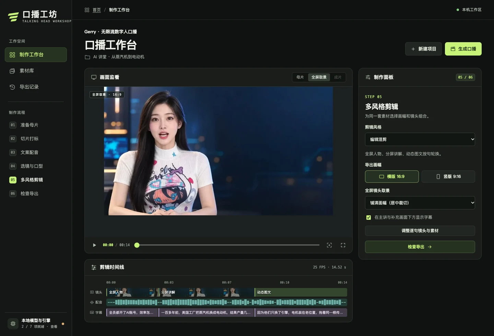

# 口播工坊 · Talking Head Workshop

**Gerry · 无限流数字人口播**。用一张单人照片或一段人物视频作母片，让指定人物朗读新稿，在本机导出带配音和字幕的横版或竖版 MP4。同一套人物素材和个人音色可以用于多篇文案。


## 首次安装

在装有 Homebrew 的 Apple Silicon Mac 上，打开终端运行以下命令。

```sh
git clone https://github.com/gerryyang2025/talking-head-workshop.git
cd talking-head-workshop
./optools.sh init
./optools.sh start
```

已有仓库可从工程目录直接运行后两条命令。`init` 会配置 Python、FFmpeg、工作台与个人音色的依赖，并下载和校验本地模型。首次初始化需要联网，以后启动服务只需 `./optools.sh start`。网页配音、口型与导出使用本机算力，无云端 token 费用。可在工作台侧栏的「本地模型与引擎」查看各项状态。[运行依赖、模型下载与校验方法](ARCHITECTURE.md#运行依赖)

[本机首页](http://127.0.0.1:8765/) · [制作工作台](http://127.0.0.1:8765/studio) · [素材库](http://127.0.0.1:8765/studio/library) · [导出记录](http://127.0.0.1:8765/studio/exports)

## 核心流程

第一次试做，点「新建项目」，准备一张嘴部清晰的单人照片、一篇短稿和一个系统音色即可。

| 步骤 | 在工作台怎么做 |
| --- | --- |
| ① 准备母片 | 从素材库导入照片或视频，设为主讲。需要穿插其他画面时，可再选多份补充素材。 |
| ② 切片打标 | 检查建议切片，调整视频入出点、表情和手势标签，去掉遮嘴或异常片段。 |
| ③ 文案配音 | 输入台词或选测试稿，准备整篇配音。完成后，时间线会显示镜头、波形和字幕。 |
| ④ 选镜与口型 | 逐句选出镜人物和镜头。可按配音时间插入多段画面，选「配图」保留原配音，选「人物口播」驱动该段人物的嘴型。 |
| ⑤ 多风格剪辑 | 组合全屏、分屏、小窗和动态图文，选横版或竖版，预览取景与字幕。 |
| ⑥ 检查导出 | 点「生成口播」，带声复核闭唇、接缝和字幕，标记问题时点，下载 MP4 和时间轴 JSON。 |

[](studio/static/showcase/workbench.webp)

**怎么选配音？** 系统音色可以直接读新稿。要用自己的音色，在「素材库 → 添加个人音色」上传清晰的单人参考录音，填写录音里实际说出的逐字稿，保存后到「文案配音」选择该音色。如果已经录好了整篇台词，直接导入音频并选「用作配音」，核对逐句边界即可。「短句试听音色」用于比较音色，整篇配音就绪后才会建立时间线。[打开文案配音](http://127.0.0.1:8765/studio/steps/voice)

## 服务与数据

- 服务管理使用 `./optools.sh status`、`logs -f`、`restart` 和 `stop`，完整用法见 `./optools.sh help`。
- 工作台默认使用 `build/studio/`。`assets/` 存上传素材和音色参考，`voices/` 存整篇配音，`jobs/` 存成片和时间轴，`studio.sqlite3` 存索引与复核记录。可通过 `KOUBO_STUDIO_DATA` 指定数据目录。
- 当前项目草稿存在浏览器本地存储。继续编辑请用同一浏览器和站点地址，清除站点数据会清除草稿。

## 命令行与 Agent Skill

- 用示例台词复跑剪辑规划、检查横竖版结果，见 [命令行示例与样片](DEMO.md)。
- 让 Agent 执行母片、选镜和音轨锁定流程，见 [口播制作 Skill](SKILL.md)。排查嘴型抢拍或句尾突然闭嘴，见 [单人口型校准 Skill](skills/portrait-lipsync/SKILL.md)。
- 修改工作台、规划器、提示词或标签时，见 [架构与维护入口](ARCHITECTURE.md)。

## 许可证

项目代码采用 [MIT 许可证](LICENSE)。第三方模型、依赖及人物和音视频素材适用各自的授权条款。
